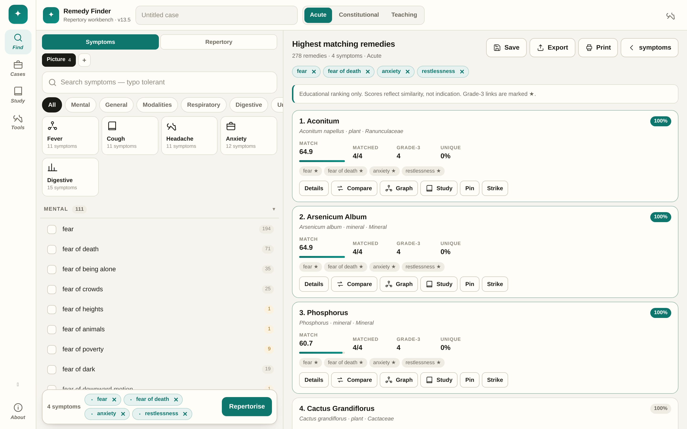
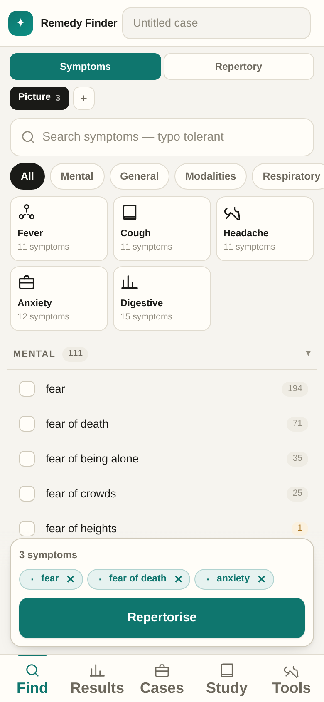
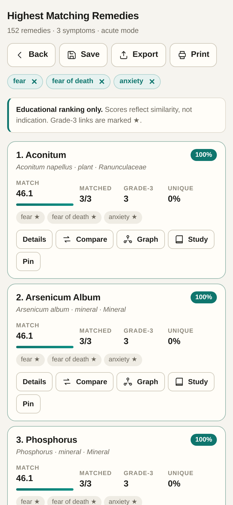
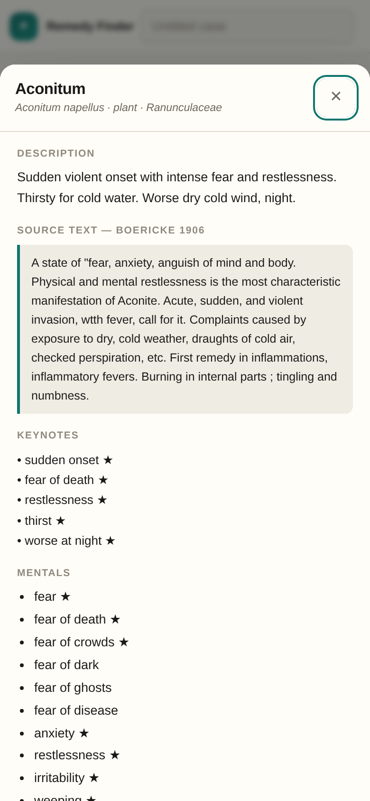

<div align="center">

# Remedy Finder

**An offline homeopathic repertory workbench — not another symptom search box.**

[](https://drsamonline.github.io/remedy-finder/)
[](dist/remedy-finder.html)
[](#architecture)
[](#offline-and-install)
[](#the-data)
[](#the-data)
[](#the-data)
[](LICENSE)



<sub>Desktop: picker and ranking side by side. Mobile: one thumb, bottom tabs, sheets.</sub>

</div>

---

## Why this exists

Most remedy finders are a search box over a list. A repertory is not a list — it is a weighted argument. Three things decide which remedy rises: **which symptoms you chose**, **how characteristic each one is**, and **how many remedies share it**. This app puts all three on screen at the same time.

- The number beside every symptom is how many of the 178 remedies carry it. Rare symptoms discriminate; the picker tells you which are rare *before* you click.
- Every symptom→remedy link carries the repertory's **grade 1–3**. Grade-3 links score higher, and ★ marks them.
- Every remedy carries a **verbatim quotation** from a public-domain materia medica, labelled with book and year — so you can read the source, not a summary of it.

## What it does

| | |
|---|---|
| **Repertorise** | 634 symptoms in 17 chapters, 5 quick packs, typo-tolerant search, live ranking in a Web Worker |
| **Remedy search** | The search box also finds remedies by name, Latin name, clinical use and family — one click opens the monograph |
| **Pin & watch** | Pin up to three remedies and change the symptoms around them; the pinned strip keeps showing each remedy’s live rank and score |
| **Text search** | A third picker mode searches the materia medica itself — descriptions, quoted sources and clinical uses across 297 monographs — with highlighted snippets and one click to the monograph |
| **Full repertory** | A second picker mode: search **31,667 rubrics** from Repertorium Publicum by words — *fear of death*, *thirst small*, *worse consolation* — and repertorise directly on rubrics, alone or mixed with curated symptoms |
| **Boards** | Keep several rubric sets inside one case — acute picture, constitutional picture, family history — switch between them, and compare their rankings side by side |
| **Interface languages** | English, हिंदी and ગુજરાતી for the finder, results and tools. Repertory terms stay in English — they are the vocabulary of the source books |
| **Symptom weight** | Mark each selected symptom strong (+) or doubtful (−); the ranking responds immediately, in both the worker and the main thread |
| **Eliminative method** | Strike remedies out as you go; a struck strip lets you restore them. Undo covers removals and deletions |
| **Rubric provenance** | Hover any symptom for the repertory rubric behind it; every monograph lists the rubric behind each keynote (`Mind > fear > death · 26 rubrics`) |
| **Grade-weighted scoring** | Chapter weights × rarity (inverse frequency) × keynote bonus × grade 1–3 × acute/constitutional mode |
| **Materia medica** | 297 remedy monographs: description, **two quoted sources side by side** (Boericke 1906, Allen 1916, Nash 1899, Clarke 1900, Guernsey 1886), rubric provenance, keynotes, mentals, generals, modalities, particulars, relationships, family |
| **Cases** | Save a repertorisation as a case, add dated follow-ups with remedy and potency, status and tags, search and sort, 30-day stale flag |
| **Exports** | Markdown report, CSV, cases JSON, Anki deck (TSV), print stylesheet, single-remedy monograph print |
| **Full-text search** | The search box also matches materia medica text, so “ague”, “monkshood” or a phrase from a description finds the remedy |
| **Study** | Spaced repetition (SM-2) from any remedy, streak, month calendar, quizzes: guess-the-remedy, differentiation, keynotes, case, narration |
| **Analysis** | Comparison matrix (up to 10 remedies), shared/unique comparison, relationship graph, family explorer, potency helper |
| **Data audit** | Built-in integrity panel: broken references, duplicate names, orphan symptoms, contradictory modalities, unverified sources — and it reports them instead of hiding them |

<div align="center">



</div>

## The data

Every link is traceable. Nothing is generated by a language model at runtime, and gaps are reported rather than filled.

| Layer | Source | Scale |
|---|---|---|
| Rubric grades | **Repertorium Publicum** (2008), Vladimir Polony — GPL v3 | 74,480 rubrics, 735,460 graded links |
| Symptom → remedy links | Mapped to this app's 634 symptoms by exact name, synonym and checked alias | **44,704 links** across 297 remedies |
| Materia medica text | Boericke 1906 · Allen 1916 · Kent 1904 · Clarke 1900 · Nash 1899 · Guernsey 1886 · Felter 1922 · Lippe 1866 · Cowperthwaite 1885 · Bell 1906 · Hale 1897 | 132 quotations |
| Source verification | Each remedy's attributed sources checked against 12 full texts | 170 / 178 remedies |
| Dataset | [`drsamonline/homoeopathic-materia-medica-repertory-json`](https://github.com/drsamonline/homoeopathic-materia-medica-repertory-json) — 72 books, 357,762 rubrics, 1,435,488 links | CC0 / GPL v3 |

**Known limits, stated plainly**

- Symptom→rubric matching is automated with a hand-checked alias table. It is right at the level of *"this remedy is in this rubric"*, not *"this is the simillimum"*.
- The Boericke extraction covers 379 of roughly 700 entries, so 46 remedies have no Boericke quote and 8 have no verified source text.
- Grades come from *Repertorium Publicum*, a Kent-derived open repertory — not from Kent 1897, whose links in this dataset are ungraded.

Full provenance: [ATTRIBUTION.md](ATTRIBUTION.md).

## Offline and install

| Route | How |
|---|---|
| **Single file** | [`dist/remedy-finder.html`](dist/remedy-finder.html) (876 KB) — curated symptoms. [`dist/remedy-finder-full.html`](dist/remedy-finder-full.html) (3.0 MB) — same app plus the complete repertory. Double-click either; no server, no install, works from a USB stick. |
| **PWA** | Open the [live app](https://drsamonline.github.io/remedy-finder/) and use *Install* / *Add to Home Screen*. A service worker caches everything; it then works with the network off. |
| **Windows** | Tagged releases attach a portable launcher produced by CI ([`build-exe.yml`](.github/workflows/build-exe.yml)). |
| **Android** | Install the PWA (above), or wrap the live URL into an APK with PWABuilder — see [docs/PACKAGING.md](docs/PACKAGING.md). |

There is **no backend, no account, no analytics, no network request at runtime.** Case data lives in IndexedDB on your device.

## Offline, and staying offline

The app never needs a network. That makes **your copy the only copy**, so there is an
explicit durability layer:

| Control | What it does |
|---|---|
| **Encrypted backup** | One file, AES‑256‑GCM with a PBKDF2 key (150,000 rounds). Written to a folder you pick once (File System Access API) or downloaded. **Verified by decrypting it back before it is called saved.** |
| **Restore from file** | Reads a `.rfb.json`, decrypts locally, shows a **preview** (exported date, data edition, record counts) before writing. Merges by record ID; a wrong passphrase fails closed. |
| **Plain JSON export** | Same payload, unencrypted, for interoperability — labelled as patient data. |
| **Download everything for offline** | Pre-caches the shell *and* the repertory file, so Repertory mode works with the network off. |
| **Readiness panel** | Service-worker state, cached file count and size, whether the repertory is available offline, record counts, and days since last backup. |
| **Backup reminder** | A dismissible banner appears when records exist and the last backup is over seven days old. |
| **Backup history** | The last ten backups, with date, record count and size, listed in the offline panel. |
| **Connection chip** | Top bar shows `offline-ready` / `offline` / `local file`, and updates as the connection changes. |

Every saved repertorisation is stamped with the **data edition** it was scored against
(`rp2008-297r-44710l`), so a case opened a year from now can say which dataset produced
its ranking.

## Two builds, one codebase

| | `remedy-finder.html` | `remedy-finder-full.html` |
|---|---|---|
| Size | 876 KB | 3.0 MB |
| Curated symptoms (634) | yes | yes |
| Full repertory search (31,667 rubrics) | no — the mode tells you so | yes |
| Load time | instant | repertory index builds in ~0.3 s on first use |

The repertory ships as a separate 1.9 MB file (`assets/repertory.js`) and is loaded **only when you open the Repertory picker**, so the default app stays small. The single-file "full" build simply inlines it.

**What the 31,667 rubrics are:** every rubric in *Repertorium Publicum* that carries at least three of this app's 178 remedies, with the printed grade kept. Rubrics with one or two remedies are dropped — they cannot discriminate between 178 remedies anyway — and the app says so rather than pretending the repertory is complete.

**How a rubric scores:** chapter weight (Mind 5, Generalities 4, modality 3, particular 2) × rarity `1 + 0.5·log₂(178/n)` × grade `1 + (g−1)·0.5`. Selected rubrics and curated symptoms add up into one ranking, so you can mix them in the same case.

## Architecture

Deliberately boring: no framework, no bundler, no npm install.

```
index.html              app shell (rail · top bar · picker · results · tab bar)
assets/app.css          design system — one stylesheet, light + dark, print
assets/data.js          window.HRF_DATA — 634 symptoms, 178 remedies, graded links
assets/app.js           data layer, index, scoring, storage, cases, SRS, exports, modals
assets/ui.js            view layer: picker, tray, results, view switching, tools sheet
sw.js                   offline cache
landing/index.html      marketing page
dist/remedy-finder.html single-file build (generated)
build.py                inlines the three assets into the single file
```

Rebuild the single file after editing:

```bash
python3 build.py     # → dist/remedy-finder.html
```

## Keyboard

| Key | Action |
|---|---|
| `/` | focus symptom search |
| `?` | shortcuts |
| `Esc` | close sheet |
| `T` · `C` · `S` · `M` · `A` · `E` | theme · cases · study · matrix · audit · explorer |

## Verification

The view and logic layers are exercised in headless Chromium: **68 method-level tests plus 100 broader checks** covering every module (storage, cases, SRS, exports, matrix, graph, audit, all modals, all header actions, the full select → repertorise → detail → export journey). Current state: **0 failures, 0 console errors** on both the modular build and the single file.

Clinical sanity check: *fear of death + restlessness + thirst for small sips + worse at night* → **Arsenicum album**, Cactus, Aconitum, Phosphorus, Cuprum. *Worse from consolation* → Ignatia, Natrum muriaticum, Sepia, Silicea.

## Author

**Dr Sohil Momin** — homeopathic physician, builder of offline-first clinical tools.
[All projects](https://drsamonline.github.io/) · [sohilmomin2000@gmail.com](mailto:sohilmomin2000@gmail.com)

## Support

One person, no company, no ads, no paid tier. If this saved you an afternoon:

| | |
|---|---|
| **UPI** | `drsohilboi@ybl` |
| **Ko-fi** | [ko-fi.com/matneo](https://ko-fi.com/matneo) |
| **PayPal** | [paypal.me/drsohilmomin](https://paypal.me/drsohilmomin) |
| **Books** | [the author's other work](https://www.amazon.com/stores/author/B08ZT331LY/allbooks) |

## Licence

**Code and interface: [PolyForm Noncommercial 1.0.0](LICENSE).** Free for personal study, teaching, charitable and public health organisations, and any noncommercial purpose. Commercial use requires a separate licence — write to the author.

**Repertory data:** *Repertorium Publicum* is **GPL v3** (as part of the OpenRep source code). Public-domain materia medicas are **CC0**. These carry their own terms; see [ATTRIBUTION.md](ATTRIBUTION.md).

<div align="center"><sub><strong>Educational tool.</strong> It ranks similarity, it does not diagnose, prescribe, or replace a qualified practitioner.</sub></div>
